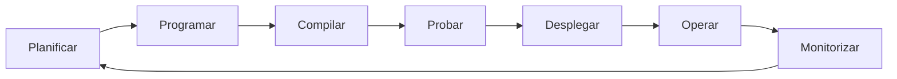
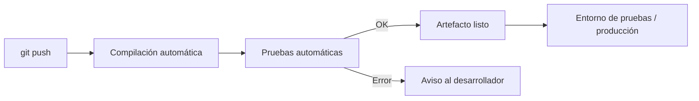

# AC0101 · ¿Qué es DevOps?

> **Módulo:** Despliegue de Aplicaciones Web
> **Ciclo:** DAW (Desarrollo de Aplicaciones Web) · Curso 2026/2027
> **Autora:** Kaori
> **Fuente:** [¿En qué consisten las DevOps? – Amazon Web Services](https://aws.amazon.com/es/devops/what-is-devops/)

---

## Índice

1. [Definición](#1-definición)
2. [Cómo funciona un equipo DevOps](#2-cómo-funciona-un-equipo-devops)
3. [Beneficios](#3-beneficios)
4. [Por qué es importante](#4-por-qué-es-importante)
5. [Cómo adoptar DevOps](#5-cómo-adoptar-devops)
6. [Prácticas de DevOps](#6-prácticas-de-devops)
7. [Herramientas de DevOps en AWS](#7-herramientas-de-devops-en-aws)
8. [Glosario rápido](#8-glosario-rápido)
9. [Conclusión](#9-conclusión)
10. [Referencias](#10-referencias)

---

## 1. Definición

**DevOps** (de *Development* + *Operations*) es la unión de tres elementos:

| Elemento | Qué aporta |
|---|---|
| **Cultura** | Una forma de trabajar basada en la colaboración y la responsabilidad compartida. |
| **Prácticas** | Métodos como la integración continua o la infraestructura como código. |
| **Herramientas** | Software que automatiza tareas que antes eran manuales. |

Su objetivo es que una organización pueda **crear, mejorar y entregar aplicaciones mucho más rápido** que con los procesos tradicionales de desarrollo y administración de sistemas. Esa rapidez le permite atender mejor a sus clientes y ser más competitiva.

---

## 2. Cómo funciona un equipo DevOps

En el modelo tradicional, *desarrollo* (quien programa) y *operaciones* (quien despliega y mantiene los servidores) trabajan por separado, como compartimentos estancos. En DevOps esa separación desaparece:

- Los dos equipos colaboran estrechamente o incluso **se fusionan en uno solo**.
- Los ingenieros participan en **todo el ciclo de vida** de la aplicación: desarrollo, pruebas, despliegue y operación.
- A veces también se integran los equipos de **calidad (QA)** y **seguridad**. Cuando la seguridad es responsabilidad de todos, se habla de **DevSecOps**.
- Se **automatizan** los procesos lentos y manuales.
- Las herramientas permiten que un ingeniero haga por sí mismo tareas que antes dependían de otro equipo (por ejemplo, desplegar código o crear un servidor).

*Ciclo de vida continuo: la información que se obtiene al monitorizar alimenta la siguiente planificación.*

---

## 3. Beneficios

| Beneficio | Explicación | Ejemplo de práctica |
|---|---|---|
| 🚀 **Velocidad** | Innovar antes y adaptarse mejor a los cambios del mercado. | Microservicios y entrega continua. |
| 📦 **Entrega rápida** | Publicar versiones con más frecuencia: nuevas funciones y correcciones llegan antes al cliente. | Integración y entrega continuas (CI/CD). |
| ✅ **Fiabilidad** | Asegurar que cada cambio funciona y es seguro, sin empeorar la experiencia del usuario. | CI/CD, monitorización y registros. |
| 📈 **Escalabilidad** | Gestionar sistemas grandes o cambiantes con menos riesgo gracias a la automatización. | Infraestructura como código. |
| 🤝 **Colaboración** | Menos esperas y malentendidos entre equipos; responsabilidad compartida. | Cultura DevOps, flujos de trabajo unificados. |
| 🔒 **Seguridad** | Ir rápido sin perder el control ni el cumplimiento normativo. | Políticas automatizadas, política como código. |

---

## 4. Por qué es importante

Hoy el software no es solo un apoyo para las empresas: **es parte central del negocio**. Las compañías se relacionan con sus clientes a través de apps y servicios online, y usan software para mejorar la logística, la comunicación o sus operaciones internas.

AWS lo compara con la **automatización industrial del siglo XX**: igual que las fábricas cambiaron su forma de diseñar y producir objetos físicos, las empresas actuales tienen que cambiar su forma de **crear y entregar software**. DevOps es la respuesta a esa necesidad.

---

## 5. Cómo adoptar DevOps

### 5.1. Cambio cultural

Adoptar DevOps es, ante todo, **un cambio de mentalidad**:

- Eliminar las barreras entre desarrollo y operaciones.
- Comunicarse con frecuencia y buscar juntos la eficiencia y la calidad.
- Sentirse **responsable del servicio completo**, más allá de lo que marque el puesto de trabajo, pensando siempre en las necesidades del cliente.
- Ver todo el ciclo de vida (desarrollo + infraestructura) como parte de la propia responsabilidad, sea cual sea la estructura de la empresa.

### 5.2. Actualizaciones pequeñas y frecuentes

Una idea clave es **publicar cambios pequeños muy a menudo** en lugar de grandes versiones de vez en cuando:

- Cada despliegue tiene **menos riesgo**.
- Si algo falla, es fácil saber **qué cambio lo provocó** y corregirlo rápido.

### 5.3. El reto y su solución

Más microservicios + más publicaciones = **muchos más despliegues**, lo que complica la operación. Por eso se combinan varias prácticas:

- **CI/CD** → despliegues rápidos, seguros y fiables.
- **Infraestructura como código y gestión de la configuración** → infraestructura elástica que se adapta a cambios frecuentes.
- **Monitorización y registros** → detectar y reaccionar pronto ante problemas.

---

## 6. Prácticas de DevOps

### 6.1. Integración continua (CI)

Los desarrolladores **suben sus cambios a un repositorio central con frecuencia** y, cada vez, se compila y se ejecutan pruebas automáticas.

**Objetivos:** encontrar errores antes, mejorar la calidad y reducir el tiempo necesario para validar y publicar actualizaciones.

### 6.2. Entrega continua (CD)

Da un paso más que la CI: los cambios se **compilan, prueban y preparan automáticamente** para llevarlos a un entorno de pruebas o de producción.

**Resultado:** siempre hay una versión (*artefacto*) lista para desplegar que ha pasado un proceso de pruebas estándar.

### 6.3. Microservicios

Forma de diseñar una aplicación como un **conjunto de servicios pequeños e independientes**:

- Cada servicio tiene **una sola función** y se ejecuta en su propio proceso.
- Se comunican entre sí mediante interfaces ligeras, normalmente **APIs HTTP**.
- Cada uno puede escribirse en un lenguaje distinto y **desplegarse por separado**.
- Reduce la coordinación necesaria para actualizar la aplicación y permite que equipos pequeños avancen rápido.

### 6.4. Infraestructura como código (IaC)

La infraestructura (servidores, redes…) se **define y gestiona con código**, aplicando las mismas técnicas que al software: control de versiones, integración continua, etc.

- En lugar de configurar recursos a mano, se hace **por programación y a escala** gracias a las APIs de la nube.
- Los servidores se pueden crear rápido a partir de patrones estándar, actualizar o **duplicar de forma idéntica**.

Dentro de la IaC destacan dos prácticas:

- **Gestión de la configuración:** se usa código para configurar el sistema operativo, los servicios y las tareas operativas. Los cambios son repetibles y estandarizados, sin configurar nada manualmente.
  *(Relación con la Práctica 0102: el script de instalación de Webmin es un ejemplo sencillo de esta idea.)*
- **Política como código:** las normas de seguridad y cumplimiento (por ejemplo, PCI-DSS o HIPAA) también se escriben como código. Así se pueden **vigilar y validar automáticamente**, y los recursos que no las cumplen se detectan (o se corrigen) solos.

### 6.5. Monitorización y registro

Se recogen y analizan **métricas y logs** de las aplicaciones y la infraestructura para:

- Saber cómo afectan los cambios a la experiencia del usuario.
- Encontrar la **causa raíz** de los problemas.
- Mantener los servicios disponibles **24/7**, cada vez más importante al aumentar la frecuencia de actualizaciones.
- Crear **alertas** y analizar datos en tiempo real para actuar de forma proactiva.

### 6.6. Comunicación y colaboración

Es uno de los pilares culturales de DevOps:

- La automatización y las herramientas compartidas **unen los flujos de trabajo** de desarrollo y operaciones.
- Se usan **chats, gestores de tareas o incidencias y wikis** para compartir información.
- Mejora la coordinación no solo entre desarrollo y operaciones, sino con otros departamentos como marketing o ventas.

---

## 7. Herramientas de DevOps en AWS

DevOps depende de buenas herramientas que automaticen tareas manuales y ayuden a gestionar entornos complejos. El artículo menciona estos servicios de AWS:

| Práctica | Servicio de AWS | Para qué sirve |
|---|---|---|
| Entrega continua | **AWS CodePipeline** | Automatizar el flujo de compilación, pruebas y despliegue. |
| Microservicios | **Amazon ECS** | Ejecutar y gestionar contenedores. |
| Microservicios | **AWS Lambda** | Ejecutar código sin gestionar servidores (*serverless*). |
| Infraestructura como código | **AWS CloudFormation** | Definir la infraestructura en plantillas de código. |
| Gestión de la configuración | **AWS Systems Manager** | Configurar y administrar servidores EC2 y locales. |
| Gestión de la configuración | **AWS OpsWorks** | Automatizar la configuración de servidores. |
| Política como código | **AWS Config** | Vigilar que la infraestructura cumple las reglas definidas. |
| Monitorización | **Amazon CloudWatch** | Métricas, logs y alertas. |
| Registro | **AWS CloudTrail** | Registrar las llamadas a la API de AWS (auditoría). |

---

## 8. Glosario rápido

| Término | Significado |
|---|---|
| **DevOps** | Cultura + prácticas + herramientas que unen desarrollo y operaciones para entregar software más rápido. |
| **DevSecOps** | DevOps con la seguridad integrada en todo el ciclo. |
| **CI** | Integración continua: fusionar cambios a menudo y probarlos automáticamente. |
| **CD** | Entrega continua: tener siempre una versión probada lista para desplegar. |
| **Artefacto** | Resultado compilado y empaquetado, listo para desplegar. |
| **Microservicio** | Servicio pequeño e independiente con una única función. |
| **API** | Interfaz que permite que dos programas se comuniquen. |
| **IaC** | Infraestructura como código. |
| **Logs** | Registros de lo que ocurre en una aplicación o sistema. |

---

## 9. Conclusión

DevOps no es una herramienta concreta, sino **una forma de trabajar**. Combina un cambio cultural (colaboración y responsabilidad compartida) con prácticas técnicas (CI/CD, microservicios, IaC, monitorización) apoyadas en la automatización. Gracias a ello las organizaciones publican cambios más pequeños y frecuentes, con menos riesgo, más calidad y mayor capacidad de adaptación.

---

## 10. Referencias

- Amazon Web Services. *¿En qué consisten las DevOps?* Disponible en: <https://aws.amazon.com/es/devops/what-is-devops/> (consultado el 27/09/2026).
